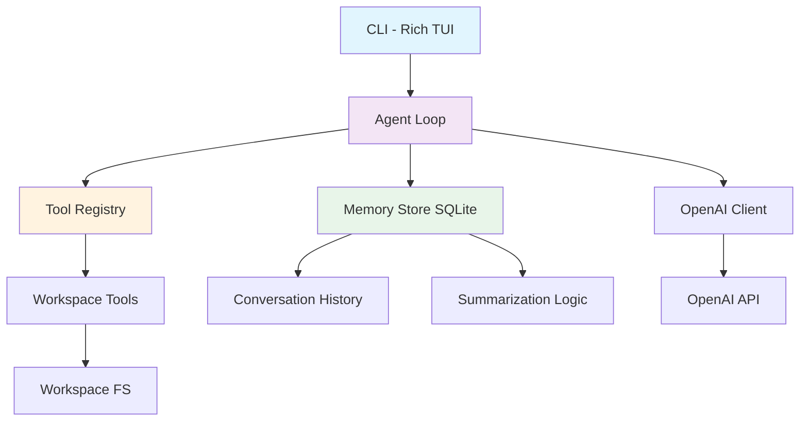

# PyPilot Architecture

> A terminal coding agent built from scratch with the OpenAI SDK (no LangChain/LangGraph), persistent memory via SQLite, and a Rich-powered CLI. This document captures architectural and design decisions made during development to serve as a reference for interviews and future work.

---

## Table of Contents

- [Overview](#overview)
- [Core Philosophy](#core-philosophy)
- [System Architecture](#system-architecture)
- [Directory Structure](#directory-structure)
- [Module Design & Decisions](#module-design--decisions)
- [Tool System](#tool-system)
- [Agent Loop & Orchestration](#agent-loop--orchestration)
- [Message Model](#message-model)
- [Memory & Persistence](#memory--persistence)
- [Configuration & Settings](#configuration--settings)
- [CLI Design](#cli-design)
- [Testing Strategy](#testing-strategy)
- [Evaluation System](#evaluation-system)
- [Dependencies & Technology Choices](#dependencies--technology-choices)
- [Known Constraints & Tradeoffs](#known-constraints--tradeoffs)
- [Future Considerations](#future-considerations)
- [Update Protocol](#update-protocol)

---

## Overview

**PyPilot** is a production-grade terminal coding agent written in Python 3.12. It operates as a ReAct (Reason + Act) agent that can explore, read, edit, write, and execute code within a sandboxed workspace. It uses the OpenAI SDK directly (migrated away from LangChain/LangGraph), maintains persistent conversation history per workspace using SQLite with automatic summarization, and provides an interactive Rich-based TUI.

**Key Characteristics:**
- Direct OpenAI SDK integration (extensible to other providers later)
- Hand-rolled agent loop with explicit control over tool execution
- Token-aware persistent memory with automatic summarization
- Workspace-scoped conversations (like OpenCode)
- Comprehensive test suite (110 tests) with no network dependencies
- Deterministic eval harness for measuring agent performance

---

## Core Philosophy

1. **Learn by building** - The user wanted to understand agent internals, so much of the implementation is explicit rather than abstracted away.
2. **Minimal dependencies** - Avoid heavy frameworks. Use standard library where possible, only add what's necessary.
3. **Runtime flexibility** - API keys, models, and providers should be configurable at runtime via CLI, not hardcoded.
4. **Safety first** - All file operations are sandboxed to a workspace root with path traversal protection. Tool failures don't crash the agent.
5. **Token consciousness** - Memory is token-aware with automatic summarization to prevent context overflow.
6. **Testability** - Everything must be testable without network calls using scripted mocks.

---

## System Architecture



### High-Level Flow

1. **Initialization**: CLI collects provider/model/API key at runtime (interactive or via flags), creates OpenAI client, instantiates Agent
2. **Session Start**: Agent loads persistent conversation for current workspace from SQLite, applies summarization if needed
3. **User Input**: Received via prompt_toolkit (or fallback to input()) 
4. **Agent Turn**: User message added to history, saved to memory, then agent loop begins
5. **Reasoning**: System prompt + conversation sent to OpenAI with tool schemas
6. **Action**: If tool calls requested, execute tools with safety checks, emit events for UI, save results to memory
7. **Iteration**: Repeat until model stops calling tools or MAX_ITERATIONS reached
8. **Response**: Final assistant message displayed, all messages persisted
9. **Summarization**: If token count exceeds threshold, summarize old messages and prune

---

## Directory Structure

```
backend/
├── src/my_agent/
│   ├── __init__.py
│   ├── agent.py          # Core agent loop, Agent class, run() function
│   ├── cli.py            # Rich TUI, REPL, argument parsing
│   ├── events.py         # Event types for streaming UI updates
│   ├── memory.py         # SQLite persistent memory with summarization
│   ├── messages.py       # Message dataclasses and OpenAI serialization
│   ├── config/
│   │   └── settings.py   # Pydantic settings for configuration
│   ├── models/
│   │   └── provider.py   # OpenAI client factory
│   └── tools/
│       ├── __init__.py   # Tool registry
│       ├── base.py       # Custom @tool decorator
│       ├── _common.py    # Workspace utilities, safety checks
│       ├── list_files.py
│       ├── glob_files.py
│       ├── search_files.py
│       ├── read_file.py
│       ├── write_file.py
│       ├── edit_file.py
│       └── run_command.py
├── tests/                # Comprehensive test suite (110 tests)
├── evals/                # Evaluation harness
└── pyproject.toml
```

---

## Module Design & Decisions

### 1. `agent.py` - The Heart of the System

**Decisions:**
- **Direct SDK over frameworks**: Migrated from LangChain/LangGraph to raw OpenAI SDK for full control and transparency
- **Synchronous design**: Uses sync OpenAI client for simplicity; streaming could be added later
- **MAX_ITERATIONS = 25**: Prevents infinite loops. After hitting limit, still executes pending tool calls to maintain valid conversation history (critical for OpenAI API)
- **System prompt rebuilt each turn**: Ensures workspace path and OS info are always current
- **Events over callbacks**: Emits `ToolCallEvent`, `ToolResultEvent`, `AssistantEvent` for decoupled UI updates
- **Result object pattern**: `AgentResult` contains new messages, usage stats, llm_calls count - agent doesn't mutate caller's history
- **Lazy client creation**: `build_agent()` can create client from settings if none provided

**Key Methods:**
- `run(messages, on_event=None, workspace=None)`: Main loop
- `_call_model()`: Prepares messages (system + conversation), adds tools if available
- `_execute_call()`: Executes tool with error handling
- `_maybe_summarize()`: Token-aware summarization trigger

### 2. `messages.py` - Type-Safe Message Handling

**Decisions:**
- **Dataclass-based types**: Clean, explicit types vs dicts
- **Bidirectional conversion**: `to_openai()` / `from_openai()` isolate SDK details
- **Tool call error handling**: Malformed JSON arguments stored with error, raw arguments preserved for API compatibility
- **Usage tracking**: Accumulates tokens across the entire run
- **Role as init=False**: Roles are implicit from class type

**Message Types:**
```python
SystemMessage   # System instructions (prepended each call)
UserMessage     # User input
AssistantMessage # Model response with optional tool_calls
ToolMessage     # Tool execution result
```

### 3. `memory.py` - Persistent Storage

**Decisions:**
- **SQLite in user home**: `~/.pypilot/memory.db` - persists across sessions, survives project moves
- **Workspace-scoped conversations**: Like OpenCode, conversations are tied to workspace path (resolved to absolute)
- **Most recent conversation auto-loaded**: Seamless continuation of work
- **Token counting with tiktoken**: Uses cl100k_base encoding for accurate gpt-4o token counting
- **Automatic summarization**: Triggers at 70% of max context (120k tokens by default)
- **Keep recent messages**: Last 10 messages always kept unsummarized for full context
- **Summary stored separately**: Summaries persisted in conversation record
- **Graceful fallback**: If tiktoken fails, uses rough estimate (len/4)

**Schema:**
```sql
conversations(id, workspace_path, title, summary, created_at, updated_at, total_tokens)
messages(id, conversation_id, role, content, tool_call_id, tool_name, tool_arguments, tool_calls_json, created_at, token_count)
```

**Summarization Strategy:**
1. Monitor total tokens of conversation
2. When > 70% of max AND > 15 messages, summarize older messages
3. Create compressed summary of tool calls, user requests, key actions
4. Delete summarized messages, keep last 10
5. Store summary for future context

### 4. `tools/base.py` - Custom Tool Framework

**Decisions:**
- **Replace LangChain @tool**: Full control, no framework lock-in
- **Type-hint driven schemas**: Automatically generates JSON Schema from Python type hints
- **Google-style docstring parsing**: Extracts description and parameter docs from Args section
- **Union/Optional handling**: Properly handles `str | None` by making optional
- **Tool object interface**: `.invoke(dict) -> str`, `.to_openai()`, `.name`, `.description`, `.parameters`
- **Always string return**: Tools return strings; errors returned as text, not raised (agent catches exceptions)
- **Forward compatibility**: Can be extended for strict mode later

**Type Mapping:**
```python
str -> string, int -> integer, float -> number, bool -> boolean
list -> array, dict -> object, Union with None -> optional
```

### 5. `tools/_common.py` - Safety & Workspace Management

**Decisions:**
- **Single workspace root**: All operations relative to workspace, configurable via `set_workspace()`
- **Path traversal protection**: `resolve_in_workspace()` validates paths stay within workspace
- **Directory ignore list**: Skips .git, node_modules, __pycache__, venvs etc.
- **Output truncation**: MAX_OUTPUT_CHARS=15000, MAX_RESULTS=200 to prevent context bloat
- **Forward slashes**: `relative_to_workspace()` uses posix paths for LLM readability

### 6. `models/provider.py` - Client Factory

**Decisions:**
- **Simple factory pattern**: `get_client()` creates configured OpenAI client
- **Fallback chain**: explicit arg → settings → env var
- **Key validation**: Raises clear error if no key found
- **Extensibility**: `base_url` for OpenAI-compatible endpoints, `model_provider` in settings for future
- **Backwards compat**: `get_model` aliased to `get_client`

### 7. `events.py` - UI Decoupling

**Decisions:**
- **Event-driven architecture**: Agent emits events, CLI subscribes via callback
- **Three event types**: `AssistantEvent` (text), `ToolCallEvent` (invocation), `ToolResultEvent` (output)
- **Synchronous callbacks**: Simple, works well with Rich spinner pattern

### 8. `config/settings.py` - Configuration

**Decisions:**
- **Pydantic Settings**: Type-safe, loads from .env automatically
- **Runtime overridable**: All values have defaults but can be overridden by CLI/env
- **Optional API key**: Allows CLI to prompt interactively
- **Sensible defaults**: gpt-4o, temp 0.0 for deterministic coding, max_tokens 4096

---

## Tool System

### Available Tools

| Tool | Purpose | Key Features |
|------|---------|--------------|
| `list_files` | Recursive directory listing | Ignores noise dirs, truncates at 200 results |
| `glob_files` | Pattern-based file finding | Uses `**` for recursive, skips ignored dirs |
| `search_files` | Regex content search | Case-sensitive, binary skip, line truncation, 200 match limit |
| `read_file` | Read with line numbers | Supports range reading (start_line/end_line), UTF-8 with replace errors |
| `write_file` | Create/overwrite files | Auto-creates parents, counts lines/chars |
| `edit_file` | Surgical replacements | Requires unique match, validates not identical, whitespace-sensitive |
| `run_command` | Shell execution | Runs in workspace cwd, timeout (1-300s), captures stdout/stderr |

### Tool Safety Guarantees
- All paths resolved through `resolve_in_workspace()` - cannot escape workspace
- `edit_file` requires unique match (prevents accidental multi-replacements)
- `run_command` has timeout protection
- Tools return error strings on failure, never raise to crash agent
- Binary files skipped in search
- Large files/outputs truncated

---

## Agent Loop & Orchestration

### Loop Algorithm

```python
conversation = list(messages)
# Load from memory if enabled
# Save new user messages
while llm_calls < MAX_ITERATIONS:
    # Check summarization need
    if use_memory: _maybe_summarize(conversation)
    
    # Call model
    response = client.chat.completions.create(
        model=model_name,
        messages=[system] + conversation,
        tools=[t.to_openai() for t in tools],
        tool_choice="auto",
        temperature=temp,
        max_tokens=max_tokens
    )
    llm_calls += 1
    accumulate_usage(response)
    
    # Parse response
    assistant = from_openai(response.choices[0].message)
    conversation.append(assistant)
    result.messages.append(assistant)
    save_to_memory(assistant)
    
    if assistant.content: emit(AssistantEvent)
    if not assistant.tool_calls: break
    
    # Execute tools
    for call in assistant.tool_calls:
        emit(ToolCallEvent)
        tool_msg = execute_call(call)  # handles errors, unknown tools
        conversation.append(tool_msg)
        result.messages.append(tool_msg)
        save_to_memory(tool_msg)
        emit(ToolResultEvent)
return result
```

### Critical Design Decisions

1. **Guard placement**: After incrementing llm_calls, if we hit limit we still execute tool calls from that response, then loop condition fails. This ensures conversation history remains valid for OpenAI API (every tool_call needs matching tool_message)
2. **System prompt per call**: Rebuilt fresh each iteration to reflect current workspace state
3. **Tool choice auto**: Let model decide when to use tools
4. **Error resilience**: All tool exceptions caught and converted to ToolMessages the model can read and recover from
5. **Event emission order**: Assistant text emitted, then for each tool call: call event, execute, result event
6. **History isolation**: Agent copies input messages, returns only new messages in result

---

## Message Model

### Serialization to OpenAI

```python
UserMessage("hi") -> {"role": "user", "content": "hi"}
AssistantMessage("thinking...", [ToolCall("c1","read_file",{"path":"x.py"})]) 
  -> {"role": "assistant", "content": "thinking...", "tool_calls": [{"id":"c1","type":"function","function":{"name":"read_file","arguments":"{\"path\":\"x.py\"}"}}]}
ToolMessage("c1", "file contents", "read_file")
  -> {"role": "tool", "tool_call_id": "c1", "content": "file contents"}
```

### Deserialization from OpenAI
- Parses tool_calls, JSON-decodes arguments
- On JSON parse failure: sets `error`, empty `arguments`, preserves `raw_arguments`
- On non-object JSON: sets error
- Errored tool calls still get tool messages with parse error so agent can retry

---

## Memory & Persistence

### Storage Location
`~/.pypilot/memory.db` (created automatically)

### Conversation Lifecycle
1. **New session**: `get_or_create_conversation(workspace)` finds most recent for workspace or creates new
2. **Loading**: `load_messages()` retrieves all messages ordered by time, applies summarization if over threshold
3. **Saving**: Every user/assistant/tool message saved immediately
4. **Summarization**: At 70% of 120k tokens with >15 messages, summarize oldest messages (keep last 10), store summary, delete old messages
5. **Listing**: `/memory` command shows conversations for current workspace

### Token Management
- **Counting**: tiktoken cl100k_base for accuracy
- **Max context**: 120,000 tokens (leaves room for response)
- **Trigger**: 70% (84,000 tokens)
- **Retention**: Last 10 messages always kept unsummarized
- **Summary**: Compressed representation of old turns (user queries truncated to 200 chars, assistant thinking to 200, tool calls listed)

### Data Model
```python
@dataclass
class MemoryStore:
    db_path: Path
    _init_db() -> None  # Create tables/indexes
    get_or_create_conversation(workspace) -> str
    save_message(conversation_id, message) -> None
    load_messages(conversation_id, max_tokens) -> (list[Message], summary)
    save_summary(conversation_id, summary) -> None
    delete_old_messages(conversation_id, keep_count) -> None
    list_conversations(workspace) -> list[dict]
```

---

## Configuration & Settings

### Settings (pydantic-settings)
```python
class Settings(BaseSettings):
    model_name: str = "gpt-4o"
    model_provider: str = "openai"
    temperature: float = 0.0
    max_tokens: int = 4096
    max_retries: int = 2
    openai_base_url: str | None = None  # For OpenAI-compatible APIs
    openai_api_key: str | None = None
    
    model_config = SettingsConfigDict(env_file=".env", env_file_encoding="utf-8")
```

### Configuration Priority
1. CLI flags (--api-key, --model, --provider)
2. Environment variables (OPENAI_API_KEY)
3. .env file
4. Settings defaults
5. Interactive prompts (if TTY)

### .env.example
```env
MODEL_PROVIDER=openai
MODEL_NAME=gpt-4o
TEMPERATURE=0.0
MAX_TOKENS=4096
MAX_RETRIES=2
OPENAI_API_KEY=
```

---

## CLI Design

### User Experience
- **Branded UI**: "PyPilot - terminal coding agent" banner with Rich panels
- **Interactive REPL**: prompt_toolkit with history (~/.pypilot_history) and command completion
- **Fallback**: Basic input() if prompt_toolkit unavailable or not a TTY
- **One-shot mode**: Pass task as argument for non-interactive use
- **Live feedback**: Spinner during thinking, colored tool call/result indicators
- **Markdown rendering**: Assistant responses rendered as Markdown with syntax highlighting
- **Safe output**: Handles encoding issues on legacy terminals

### Commands
- `/help` - Show available commands
- `/model` - Display active provider and model
- `/tools` - List available tools with descriptions
- `/workspace` - Show current workspace directory
- `/memory` - Show stored conversations for workspace
- `/reset` or `/clear` - Clear conversation history in session
- `/exit` or `/quit` or `/q` - Exit

### Flow
```python
main(argv):
    parse_args()
    _make_output_safe()
    provider, model_name, api_key = configure(args)  # Interactive setup if needed
    client = get_client(api_key=api_key)
    agent = Agent(client, model_name=model_name)
    if args.prompt: run_once(agent, " ".join(args.prompt))
    else: repl(agent, provider, model_name)
```

### Rendering
- `print_banner()`: Shows app name, tagline, provider, model, workspace
- `print_assistant()`: Renders Markdown with PyPilot branding
- `print_tool_call()`: Yellow bullet with tool name and brief args
- `print_tool_result()`: Dim bullet with first line of result
- `run_turn()`: Orchestrates spinner, event handling, history updates

---

## Testing Strategy

### Philosophy
- **No network calls**: All tests use scripted mocks
- **Fast execution**: 110 tests run in ~11 seconds
- **Comprehensive coverage**: Tools, agent loop, CLI, memory, messages, provider
- **Deterministic**: ScriptedClient replays queued responses

### Test Structure
```
tests/
├── conftest.py         # Shared fixtures (workspace temp dir)
├── helpers.py          # ScriptedClient, fake_response, tool_call helpers
├── test_agent.py       # Agent loop, tool execution, iteration limits, events
├── test_cli.py         # CLI rendering, commands, REPL, main wiring
├── test_eval_tasks.py  # Eval checker validation (golden solutions)
├── test_evals_runner.py # Eval runner plumbing
├── test_messages.py    # Message serialization/deserialization
├── test_provider.py    # Client factory
└── test_tools.py       # All 7 tools, safety checks, error cases
```

### Key Test Patterns
- **Tool tests**: Use real tools against temp workspaces via fixtures
- **Agent tests**: ScriptedClient with fake_response() sequences
- **CLI tests**: Monkeypatch console to StringIO, fake agents
- **Memory tests**: Use temp SQLite DBs
- **Parametrized**: Eval task validation uses parametrization

### Test Doubles
```python
class ScriptedClient:
    def __init__(self, responses=None):
        self._responses = list(responses or [])
        self.requests = []  # Record all calls
        self.chat.completions.create = self._create
    
    def _create(self, **kwargs):
        self.requests.append(kwargs)
        if self._responses: return self._responses.pop(0)
        return fake_response(content="done")

def fake_response(content="", tool_calls=None, prompt_tokens=10, completion_tokens=5):
    # Returns OpenAI-like response object
```

---

## Evaluation System

### Purpose
Deterministic evaluation of agent capabilities without API costs during testing.

### Design
- **Pure checkers**: Functions that inspect workspace state and/or agent answer
- **Sandboxed execution**: Each task runs in isolated temp directory
- **Opt-in**: Requires API key, marked with `@pytest.mark.eval`
- **Real agent**: Uses actual Agent with real tools

### Tasks
1. **create_file**: Create greet.py printing "Hello, World!"
2. **fix_bug**: Fix subtraction bug in add() function
3. **add_function**: Add is_palindrome() to strings_utils.py
4. **explore_report**: List Python files and count them
5. **make_test_pass**: Fix failing test

### Usage
```bash
uv run python -m evals.run_evals                # All tasks, gpt-4o-mini
uv run python -m evals.run_evals --only fix_bug # Single task
uv run python -m evals.run_evals --list         # List tasks
EVAL_MODEL=gpt-4o uv run python -m evals.run_evals
```

### Metrics Tracked
- Pass/fail with details
- Number of turns (llm_calls)
- Number of tool calls
- Token usage
- Execution time

---

## Dependencies & Technology Choices

### Runtime Dependencies
```toml
dependencies = [
    "fastapi>=0.141.1",      # Web framework (present but not heavily used yet)
    "ipython>=9.17.1",       # Interactive shell (legacy)
    "openai>=3.37.0",        # OpenAI SDK - core LLM integration
    "pydantic>=2.13.5",      # Data validation
    "pydantic-settings>=2.15.0", # Settings management
    "rich>=15.0.0",          # Terminal UI/formatting
    "sqlalchemy>=2.0.53",    # ORM (present but using sqlite3 directly)
    "sqlmodel>=0.0.42",      # SQLModel (present)
    "supabase>=2.31.0",      # Cloud DB (present but unused)
    "uvicorn>=0.53.0",       # ASGI server
]
```

### Added Later
```bash
uv add tiktoken  # For accurate token counting
```

### Dev Dependencies
```toml
[dependency-groups]
dev = ["pytest>=9.1.1"]
```

### Rationale

- **OpenAI SDK over LangChain**: User requested migration for learning - want to understand internals. Direct SDK gives full control.
- **Rich over prompt_toolkit alone**: Beautiful markdown rendering, tables, panels, spinners
- **SQLite over external DB**: Simple, local, no server needed, perfect for conversation storage
- **tiktoken**: Accurate token counting for context management
- **pydantic-settings**: Clean .env loading with type safety
- **pytest**: Standard, simple, great fixture system

---

## Known Constraints & Tradeoffs

### Design Tradeoffs

| Decision | Tradeoff | Rationale |
|----------|----------|-----------|
| Synchronous SDK calls | No streaming responses | Simpler to reason about, easier to test, events still provide progress |
| Direct SQL with sqlite3 | Not using SQLAlchemy/SQLModel despite being deps | More explicit, less abstraction, easier to understand |
| Store all messages | DB grows over time | Summarization mitigates; can add cleanup later |
| System prompt every turn | Uses more tokens | Ensures workspace context is fresh |
| MAX_ITERATIONS=25 | May stop complex tasks early | Prevents runaway costs/loops; guard executes pending tools |
| Tool calls must be unique in edit_file | More verbose edits needed | Prevents accidental multi-replacements |
| No multi-provider yet | Only OpenAI works | Extensible via get_client/base_url; added provider field for future |

### Limitations

- **Single provider**: Only OpenAI implemented (architecture ready for others)
- **No streaming**: Responses come all at once
- **No sub-agents**: Single agent only
- **No tool result truncation in history**: Tool results saved fully to DB (summarization handles later)
- **Windows-focused paths**: Uses pathlib but tested on Windows
- **No conversation branching**: Linear conversation per workspace
- **Summary generation is naive**: Simple truncation-based summary, not LLM-powered yet

---

## Future Considerations

### Planned Enhancements (from user)
- [ ] Add other LLM SDKs (Anthropic, Google, etc.)
- [ ] Implement proper LLM-powered summarization (use cheap model)
- [ ] Add conversation management UI (switch between conversations)
- [ ] Add permission system for dangerous tools (run_command)
- [ ] Add context/ and permissions/ directories (mentioned in original plan)
- [ ] Make `pypilot` a proper CLI entry point via pyproject scripts

### Potential Improvements
- [ ] Async support for better concurrency
- [ ] Streaming responses from OpenAI
- [ ] Tool result caching
- [ ] Better token estimation
- [ ] Conversation export/import
- [ ] Custom system prompts per project
- [ ] Rate limiting/retry logic improvements

---

## Update Protocol

**IMPORTANT:** From this point forward, whenever any architectural decision, major refactor, new module, or significant design choice is made to this project, `architecture.md` MUST be updated to reflect it.

This includes:
- Adding new modules or changing module responsibilities
- Changing agent loop logic
- Modifying tool system
- Changing memory/storage strategy
- Adding dependencies
- Changing configuration approach
- Modifying CLI architecture
- Updating testing strategy
- Any tradeoffs made

The update should be comprehensive and interview-ready, explaining the "why" behind decisions.

---

*Last Updated: October 26, 2026*  
*Maintained by: AI Agent (with user guidance)*
